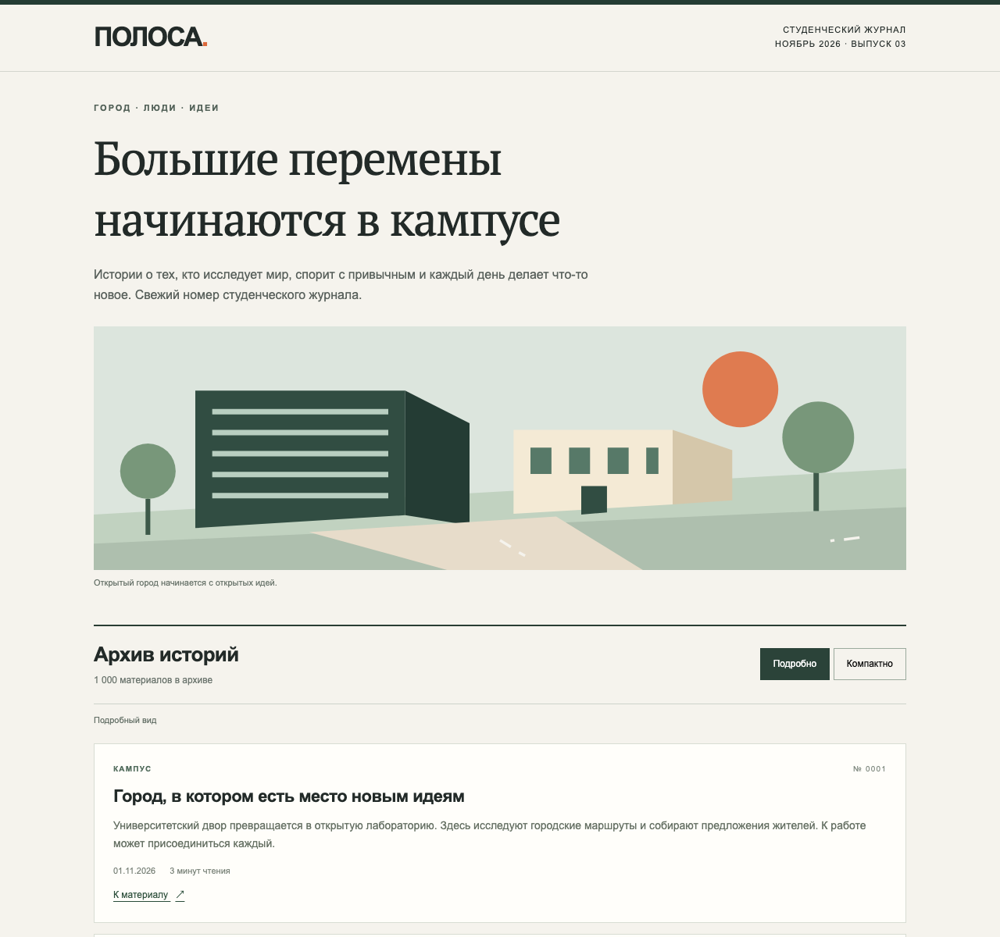
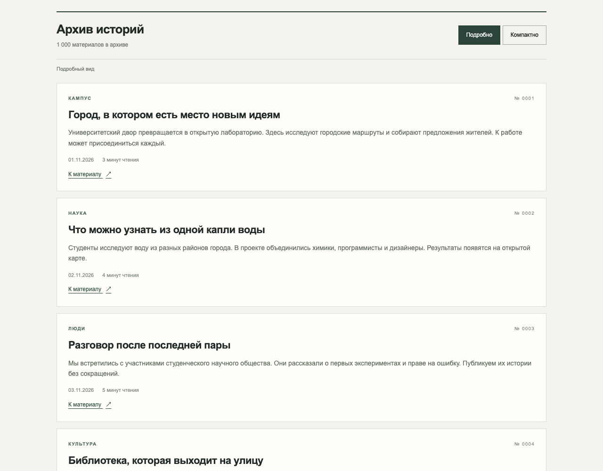
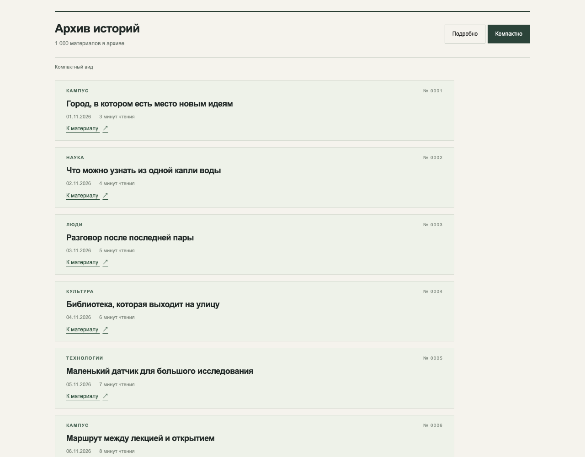

# Ожидаемое поведение

Контрольные снимки сделаны после загрузки ресурсов при ширине 1280 CSS-пикселей. Они показывают целевое оформление; в исходном клиентском коде есть ошибки, которые мешают получить все эти состояния корректно.

## Верх страницы

Название журнала, заголовок, вводный текст и иллюстрация сохраняются. Иллюстрация не должна менять пропорции или обрезаться. Место для неё должно быть предусмотрено до завершения загрузки.

## Подробный вид

Карточка занимает всю ширину ленты. Видны категория, номер, заголовок, **все три фразы описания**, дата, время чтения и ссылка.

## Компактный вид

Карточки сжимаются до 84% ширины ленты и остаются прижатыми к её левому краю. Меняются фон, отступы и размер заголовка. **Описание полностью скрывается**; остальные сведения сохраняются. Число карточек, их порядок и тексты в DOM не изменяются.

Шапка и обложка при переключении вида не меняются. Кнопка текущего вида отмечена тёмным фоном. Ссылка «К материалу» ведёт к якорю собственной карточки; отдельная страница статьи в этом задании не предусмотрена.
